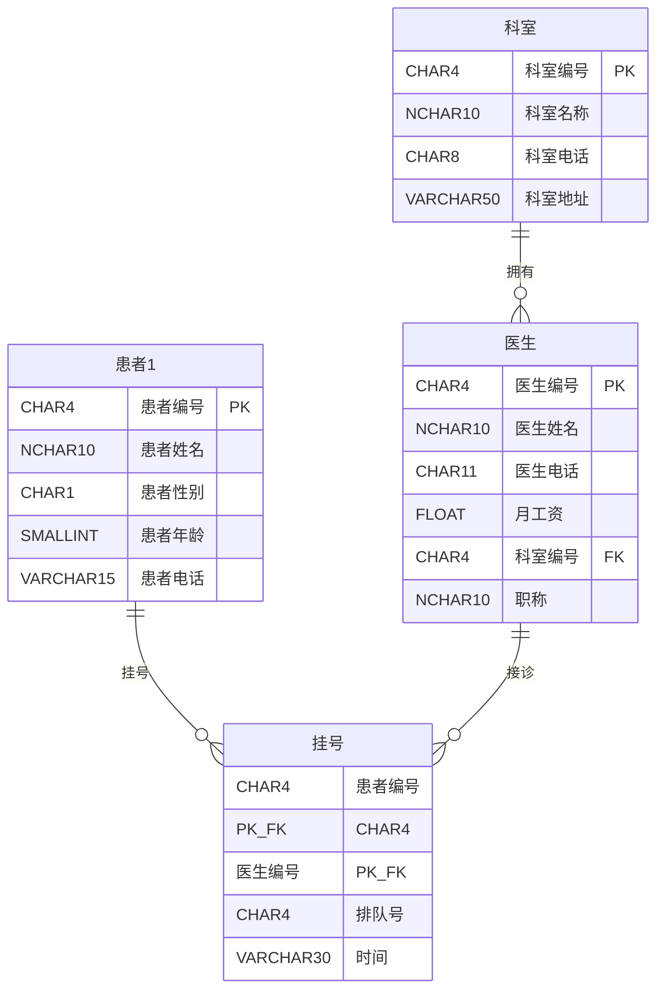

# SQL Server 数据库课程设计

> **EN** — Two SQL Server databases from a database course design — hospital registration and car rental — covering constraints, joins, subqueries, indexes, views and triggers.

两个 SQL Server 数据库设计：一个面向医疗挂号业务，一个面向租车业务。脚本以 T-SQL 编写，在 SSMS 中按批执行。


## 目录

```
database-course-design/
├── register/
│   └── register.sql    # 医疗挂号系统，400 行，完整建库到触发器
├── rent/
│   └── rent.sql        # 租车系统，76 行，约束 / 流程控制 / 系统存储过程
├── LICENSE
└── README.md
```

---

## 一、register：医疗挂号系统

### 实体关系



`挂号` 以 `(患者编号, 医生编号)` 复合主键表达"某患者挂某医生的号"这一二元关系，一个人对同一位医生不会有两笔并行挂号。

### 约束设计

| 约束名 | 位置 | 作用 |
|---|---|---|
| `CK_sex1` | 患者1.患者性别 | 只允许 `'M'` / `'F'` |
| `CK_age1` | 患者1.患者年龄 | 0 < 年龄 < 130 |
| `CK_phone` | 科室.科室电话 | 8 位定长数码，`LIKE '[0-9][0-9]...'` |
| `CK_phone1` | 医生.医生电话 | 11 位手机号 |
| `CK_money` | 医生.月工资 | 大于 0 |
| `CK_order` | 挂号.排队号 | 大于 0 |

字符类约束用 `LIKE` 逐位展开而不是 `ISNUMERIC`，因为后者会把 `'1e5'`、`' +1'`、`'$1'` 都判为数字，管不住长度。

### 脚本覆盖的实验内容

脚本按课设实验顺序推进，一条链路走完数据库的主要对象：

1. **建库** —— 显式指定文件组：主数据文件 5 MB、两个次数据文件、两个日志文件，练习 `FILEGROWTH` / `MAXSIZE` 参数
2. **建表与约束** —— 4 张表，含 `PRIMARY KEY`、`FOREIGN KEY`、`CHECK`
3. **表结构演进** —— `ALTER TABLE ... ADD` 补加患者电话、`ALTER COLUMN` 放宽科室地址长度
4. **数据操作** —— `INSERT` 示例数据、`UPDATE`、`DELETE`
5. **查询** —— 单表条件查询、三表连接、`GROUP BY` 聚合、`IN` 子查询
6. **索引** —— 单列索引 `IX_患者姓名`、升降序混合的复合索引 `IX_科室名称_科室地址`，以及 `DISABLE` / `REBUILD` / `sp_rename`
7. **视图** —— `VIEW_科室信息`（连接）、`VIEW_挂号`（聚合统计），并用 `ALTER VIEW` 重定义
8. **触发器** —— `TRIG_科室` 对科室表的 `INSERT` / `UPDATE` / `DELETE` 抛 `RAISERROR`，并用 `DISABLE TRIGGER` 验证

### 几个值得说明的选择

**患者电话用 `ALTER TABLE` 后加**，而不是写在建表语句里——这是刻意练习表结构变更，同时演示 `NULL` 列可以直接追加到已有表上。

**复合索引 `IX_科室名称_科室地址`** 用了 `科室名称 ASC, 科室地址 DESC`。原脚本这样写在单表查询上用不到索引的全部收益，但它是为了练习混合排序方向的语法，符合课设的实验目标。

**触发器用 `RAISERROR` 而不是 `ROLLBACK`**，所以它只发警告不阻断操作，后续 `DELETE FROM 科室 WHERE 科室编号='R006'` 依然能执行——这正好用来演示 `DISABLE TRIGGER` 的效果。

---

## 二、rent：租车系统

`rent.sql` 是在已建好的租车库上做**约束补全与查询演练**，包含：

- `ALTER TABLE ... ADD CONSTRAINT` 加唯一约束 `UQ_租车公司名称`、默认值 `DF_价格`、检查约束 `CK_时间`
- `IF EXISTS` + 子查询统计某类公司名下车辆数
- `CASE` 表达式做客户等级分段（按租车时长划为钻石/白金/金/银卡/普通）
- `WHILE` 循环累加 1~99
- `sp_help` / `sp_helpdb` / `sp_helpfile` / `sp_tables` / `sp_columns` 系列系统存储过程

> **注意**：本脚本不含 `rent` 库的 `CREATE DATABASE` 与 `CREATE TABLE` 语句——原课设中建库建表在 SSMS 图形界面完成，脚本只记录了约束与查询部分。脚本开头会检查库是否存在，不存在则提示并退出。

---

## 如何运行

### 前置

- SQL Server 2016 或更高（脚本用到 `ALTER INDEX ... REBUILD`）
- SSMS 或 `sqlcmd`
- `register.sql` 会向 `C:\SQLData\` 写数据文件，**运行前先创建该目录**，或把脚本里的 `FILENAME` 改成你自己的路径

### 执行

```sql
-- 方式一：SSMS 打开脚本，F5 执行
-- 方式二：命令行（注意 -f 65001：脚本是 UTF-8，不加会让中文标识符变 ??）
sqlcmd -S localhost -E -f 65001 -i register\register.sql
sqlcmd -S localhost -E -f 65001 -i rent\rent.sql
```

`register.sql` 开头带幂等保护，重复执行会先 `DROP DATABASE` 再重建：

```sql
IF DB_ID('register') IS NOT NULL
BEGIN
    ALTER DATABASE register SET SINGLE_USER WITH ROLLBACK IMMEDIATE;
    DROP DATABASE register;
END
GO
```

---

## CI 验证

CI 不止数 `CREATE` 语句的个数——它会起一个 SQL Server 2022 容器，真的把库建出来，再验收对象、试插非法数据看约束拦不拦。

真跑之后暴露出一批**脚本本身跑不通**的问题（这些问题静态检查永远看不见，因为脚本以前一直是分段在 SSMS 里执行、从没整体跑过）：

- `CREATE DATABASE` 后面缺 `GO`，紧跟了 `ALTER DATABASE` —— 建库语句必须独占一个批处理
- `ALTER DATABASE ... ADD FILE` 后面同样缺 `GO`，直接跟了 `USE`
- `患者1` 表 `CONSTRAINT CK_age1` 后多了一个逗号，紧接右括号
- `医生` 表 `职称 NCHAR(10) NOT NULL` 后面缺逗号，直接跟 `FOREIGN KEY`
- `挂号` 表 `CONSTRAINT CK_order` 后同样多了逗号
- `sp_rename` 的字符串被换行切成了两行 —— T-SQL 的字符串字面量不能跨行
- `sp_rename` 的 `@objname` 少了 schema 前缀，服务端把「科室」当成了 schema（Msg 15248）
- 脚本中段误粘了三段 `USE rent` 的租车查询（Msg 911），已移除

跑 CI 时还会撞上两个环境问题，README 里一并记下：

1. **实例排序规则**。容器默认 `Latin1`，中文标识符和 `sp_bindrule 'RL_职称'` 这类字符串参数会变成 `??`。CI 用 `MSSQL_COLLATION=Chinese_PRC_CI_AS` 还原原课设的环境，并先断言排序规则确实生效，避免把环境问题误判成脚本问题。
2. **输入编码**。`sqlcmd` 默认按系统代码页读文件，UTF-8 的脚本要显式 `-f 65001`。

验收脚本 `scripts/verify_register.sql` 会检查 4 表 / 2 索引 / 2 视图 / 1 过程 / 1 触发器 / 5 约束是否真的存在，并插入一条非法性别的记录确认 `CK_sex1` 真的拦得住。`rent.sql` 因为没有建表语句（原课设在 SSMS 里手工建库），CI 用 `scripts/stub_rent.sql` 造最小桩库再跑，否则它开头的 `IF DB_ID('rent') IS NULL RETURN` 会让测试永远"成功"。

## 本次整理所做的改动

源脚本是 GBK 编码、当作作业交上去的版本。为了能公开发布，做了这些处理：

- **GBK → UTF-8** —— 否则 GitHub 上中文表名全部乱码。
- **数据文件路径改为 `C:\SQLData\`** —— 原路径里带学号，移除。
- **10 个示例手机号改为 `13800000001` 等占位号** —— 避免看起来像真实号码；位数不变，`CHECK` 约束仍可通过。
- **`'P0O1'` 改为 `'P001'`、`'RO01'` 改为 `'R001'`** —— 原脚本笔误：字母 `O` 误当数字 `0`，与挂号表、医生表的外键引用对不上，会导致 `INSERT` 违反外键约束。
- **增加 `DROP DATABASE` 幂等保护** —— 原脚本执行第二次会因库已存在而失败。
- **排除 `*.mdf` / `*.ndf` / `*.ldf`** —— SQL Server 二进制数据文件，不适合版本管理。

示例数据中的姓名与科室均为虚构。

---

## 许可证

[MIT](LICENSE)
